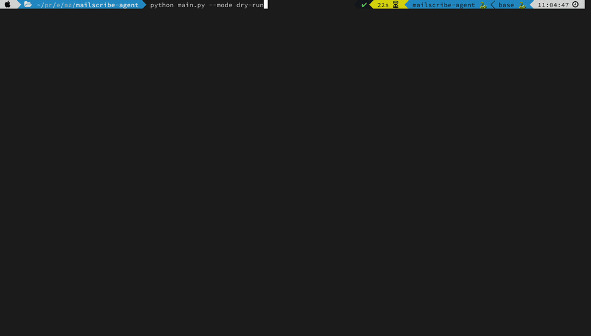

# Mail-to-Sheet AI Agent

An AI agent that reads freeform, unstructured emails from any inbox,
extracts whatever structured data you define, and keeps a Google Sheet in
sync automatically, updating existing rows and adding new ones on a
schedule.

Built to be genuinely generic: the fields it extracts are defined in a
config file, not hardcoded, so the same agent works for invoices, support
tickets, leads, event RSVPs, or anything else that shows up in an inbox
without any code changes.

## Demo



Five very different emails go in (an invoice, a bug report, a cold intro,
an automated digest, and a reschedule request) and clean, structured
fields come out, each with a confidence rating. This is dry-run mode, so
it needs nothing but an Anthropic API key.

## Why this exists

Most "email to spreadsheet" tools assume every email follows the same
template. Real inboxes don't work that way, wording, structure, and
formatting vary from sender to sender. This agent uses Claude to read
each email the way a person would and pull out exactly the fields you
care about, rating its own confidence in each result so doubtful ones
stand out instead of being guessed at.

## Why it's useful

Email is where a lot of business data arrives, and almost none of it
arrives in a usable shape. Someone ends up reading each message and
retyping the key details into a spreadsheet. It is slow, easy to get
wrong, and it stops whenever that person is busy or away.

This agent takes over that job:

- **Works on messy, real-world email.** No templates, regex rules, or per-sender parsers. It reads each message the way a person would, so a new sender or a changed format does not require new rules.
- **Saves the copy-paste work.** New emails become rows in your sheet on a schedule, so your team checks one sheet instead of combing an inbox.
- **Fits your process without code changes.** Describe the fields you care about in a YAML file and the same agent extracts invoice data, support tickets, leads, or anything else.
- **Safe to re-run.** Rows are matched on a unique key, so a retry or a catch-up after downtime updates existing rows instead of creating duplicates.
- **Does not invent data.** A field that is not in the email is recorded as "None" rather than guessed, and every extraction carries a confidence rating so uncertain ones can be reviewed.
- **You stay in control.** It runs on your own machine or server with your own credentials. Gmail access is read-only, and email content is sent only to the Anthropic API for extraction.
- **Cost scales with volume.** One short model call per email, and none when there is nothing new.

### Example uses

| Inbox | Fields you might extract |
|---|---|
| Accounts payable | vendor, invoice number, amount, due date |
| Customer support | customer, issue category, urgency, affected product |
| Sales and partnerships | sender, company, request, timeline |
| Scheduling | requester, current slot, requested slot |
| Operations alerts | service, severity, ticket ID, action needed |

Edit the `fields` list in `config/schema.example.yaml` and the same
agent handles any of these.

## Features

- **Config-driven extraction**: define your field list in a YAML file, not in code
- **Works with Gmail or any IMAP inbox**: Outlook, Yahoo, iCloud, self-hosted
- **Idempotent Google Sheets sync**: updates existing rows by a unique key instead of duplicating them, safe to re-run or recover from downtime
- **Scheduled or on-demand**: run once, or continuously on an interval
- **Dry-run mode**: see it work against sample emails in under a minute, no credentials required beyond an Anthropic API key
- **Confidence ratings**: every extraction is rated high or low, shown in dry-run output and counted in each run's summary, so ambiguous emails are surfaced instead of silently guessed

## Architecture

See [`docs/architecture.md`](docs/architecture.md) for the full diagram and
the reasoning behind the upsert logic, the config-driven schema, and the
dedupe strategy. Short version:

```
Email Source (Gmail/IMAP) → Dedupe → Claude Extraction → Sheets Upsert → Google Sheet
                                ↑                              
                          Scheduler (hourly, configurable)
```

## Quick start (dry run, ~1 minute)

No Google credentials needed for this part, just an Anthropic API key.
Python 3.11 or newer is recommended. The core install is only the
Anthropic SDK, PyYAML, and python-dotenv, so dry-run never loads any
Google libraries.

```bash
git clone https://github.com/azambd/mailscribe-agent.git
cd mailscribe-agent
python3 -m venv venv && source venv/bin/activate
pip install -r requirements.txt

cp .env.example .env
# Edit .env and add your ANTHROPIC_API_KEY

python main.py --mode dry-run
```

This runs the extraction engine against five synthetic sample emails
(an invoice, a support request, a lead inquiry, an automated digest, and
a reschedule request) and prints the structured output for each.

## Full setup (live Gmail + Google Sheets)

0. **Install the live dependencies** (on top of the core install above):

```bash
pip install -r requirements-live.txt
```

1. **Google Cloud project**: enable the Gmail API and Sheets API
2. **Gmail OAuth**: create an OAuth client (Desktop app type), download as `credentials.json`. First run will open a browser for one-time login and save `token.json`.
3. **Google Sheets service account**: create a service account, download its key as `service_account.json`, then share your target Google Sheet with the service account's email address (Editor access)
4. **Configure fields**: copy `config/schema.example.yaml` to `config/schema.yaml` and edit the `fields` list for your use case, plus set your `spreadsheet_id` and `worksheet_name`
5. Run:

```bash
python main.py --mode once --config config/schema.yaml       # single run
python main.py --mode schedule --config config/schema.yaml   # continuous, hourly by default
```

### Using IMAP instead of Gmail

Set `source.type: imap` in your config file and fill in `imap_host`,
`imap_port`, `imap_username`, plus `IMAP_PASSWORD` in `.env` (use an
app-specific password, not your regular login password, for providers
that support it).

## Project structure

```
mailscribe-agent/
├── main.py                      # CLI entry point
├── config/
│   └── schema.example.yaml      # field list + sync/schedule settings
├── src/
│   ├── config.py                # settings loader
│   ├── agent.py                 # orchestration, dedupe, state
│   ├── scheduler.py             # interval-based runner
│   ├── dry_run.py                # sample-data demo mode
│   ├── email_sources/           # Gmail + IMAP adapters (pluggable)
│   ├── extraction/               # Claude-powered field extraction
│   └── sync/                    # Google Sheets upsert logic
├── sample_data/
│   └── sample_emails.json       # synthetic emails for dry-run mode
└── docs/
    └── architecture.md
```

## Tech stack

Python 3.11+, Claude (Anthropic API), Gmail API, Google Sheets API,
APScheduler.

## Extending this

- **New email source**: implement `EmailSource.fetch_new()` in
  `src/email_sources/`, following the pattern in `gmail_source.py` or
  `imap_source.py`. Nothing else needs to change.
- **New destination** (Airtable, Notion, a database): implement the same
  `upsert_rows()` interface as `SheetsSync` and swap it in `agent.py`.
- **Notifications**: `agent.run_once()` returns a summary dict
  (`fetched`, `new`, `updated`, `appended`, `low_confidence`); wire that
  into an email, Slack, or webhook call after each scheduled run.

## License

MIT, see [LICENSE](LICENSE).

---

Built by [Faruque Azam](https://www.linkedin.com/in/faruque/), Data with AI Integrator & Agent
Developer at [Webtario](https://webtario.com), a web data extraction and
AI automation studio.
