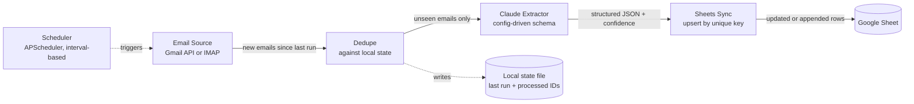

# Architecture

## Flow

## Why upsert instead of append-only

The client requirement was "update or add new lines" — not just append. A
naive pipeline that only appends will duplicate a row every time it
re-processes an email it's already seen, which happens constantly in
practice: a provider's date filter has a few hours of overlap, a run gets
retried after a failure, or the schedule catches up after the machine was
asleep.

Every row is keyed by the email's own unique message ID. On each run, the
sync layer reads the existing key column from the sheet, and for each new
extraction: if the key is already there, it overwrites that row in place;
if not, it appends a new one. This makes every run idempotent — running
the same batch of emails through the agent five times in a row produces
the exact same sheet as running it once.

## Why the schema is config, not code

Hardcoding field names ("sender", "amount", "deadline") ties the agent to
one use case. Instead, `config/schema.example.yaml` defines the fields as
a list of `{name, description}` pairs, and that list is what gets
compiled into Claude's system prompt at runtime. Point the same code at a
different YAML file and it extracts invoice data, support-ticket data, or
lead-qualification data — no code changes required.

## Why dedupe happens in the agent, not the source

Gmail's `after:` query and IMAP's `SINCE` search are both date-only
granularity, not timestamp-precise. That means every fetch has a small
window of overlap with the previous one by design — this is intentional,
not a bug, since it's the safest way to guarantee nothing is missed if a
run is late or fails. The actual "have I seen this already" check happens
in `agent.py` against a local list of processed message IDs, which is
the only thing that can be timestamp-precise.

## Why local state instead of a database

For a single-mailbox agent running on a schedule, a JSON file with the
last run time and a capped list of processed IDs is enough, and it's one
less moving part to deploy and monitor. If this were scaled to many
mailboxes or high email volume, that state would move to Redis or a small
Postgres table — the interface (`_load_state` / `_save_state` in
`agent.py`) is intentionally isolated so that swap wouldn't touch any
other module.
